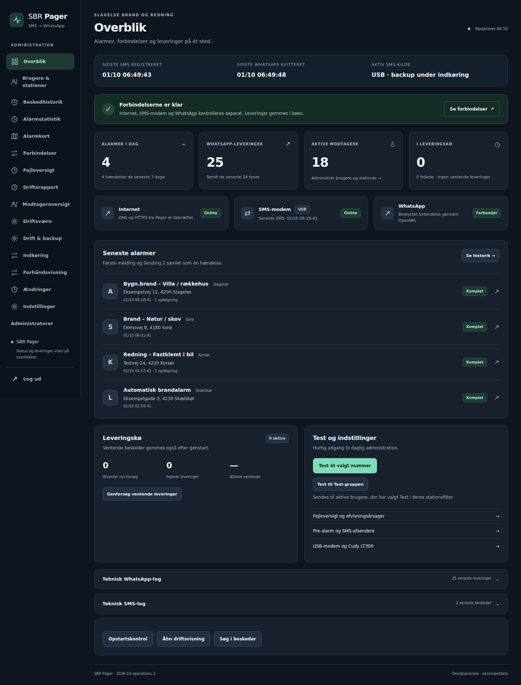

# SBR Pager · opdatering og Cudy LT300

Opdateringen bygger videre på `feature/sms-whatsapp-gateway` og bevarer
SIM800C USB-seriel, OpenWA-session, stationsvalg, Test opt-in og datavolumener.
Den er forberedt på branchen `codex/pager-reliability-review`.
Den bliver ikke automatisk installeret på racherserver.

## Opdater med dit nuværende USB-modem

Kør på **racherserver**, ikke racher-pi2:

```bash
cd /opt/SBR-Pager-Gateway
git status --short
git remote set-branches --add origin codex/pager-reliability-review
git fetch origin codex/pager-reliability-review
git switch codex/pager-reliability-review
git merge --ff-only origin/codex/pager-reliability-review
bash scripts/update-sbr-pager.sh
```

Hvis checkout afvises på grund af lokale kodeændringer, skal de først afklares.
Undlad `git reset --hard`. Den eksisterende `.env` er ignoreret af Git og beholdes.
Hvis `.env` ikke indeholder `SMS_MODEM_DRIVER`, bruges USB automatisk.
Behold den eksisterende `SMS_MODEM_HOST_DEVICE` og baudrate.

Scriptet tager konsistente SQLite-backups, kopierer `.env` til en beskyttet
backupmappe og tagger de to gamle images, før noget udskiftes. Det bygger og
validerer de nye images og pauser kun aktive watchdog-timere under genstarten.
OpenWA-containeren og dens login genskabes ikke. Hvis genstart/health fejler,
forsøger scriptet at starte de tidligere images igen.

Databasen udvides med en separat kildekvitteringstabel. Eksisterende tabeller
ændres ikke. SQLite foreign-key-kaskader er aktiveret i Pager, så sletning
også rydder tilhørende retry-state og kvalitetsbeslutninger.

Efter opdateringen vises modem, WhatsApp og kø på Overblik. En almindelig
testalarm skal behandles gennem det eksisterende Test opt-in; scriptet sender
ingen beskeder. `Send testbesked` i UI er en brugerhandling.

## Den planlagte drift: LT300 til internet og SMS

### Skift fra en stoppet USB-gateway til LT300

LT300 V3.0 med firmware 2.5.12 har under indkøring svaret på driverens
login og AT-statusprøve. Firmware leverer login-formularen med HTTP 403;
driveren accepterer kun dette svar, hvis en genkendelig login-formular findes.
Den 2. oktober 2026 blev opdateringen installeret på racherserver. Operatøren
bekræftede kort SMS og derefter en samlet lang SMS med danske tegn i WhatsApp.
Genstart er også fysisk bekræftet: boot-service og alle tre applikationer
startede korrekt, og operatøren bekræftede SMS efter genstart.
Netværksudfald og USB-skift er endnu ikke fysisk bekræftet.

**På den senest afprøvede LT300 V3 skal Cudy-appens SMS → Aktivér være
slået til permanent.** Testen 5. oktober viste, at routeren kan oprette en
Outbox-post uden at sende, hvis dens SMS-engine er slået fra. Readeren sikrer
automatisk aktivering ved opstart og kontrollerer den normalt hvert 60. sekund.
`CUDY_SMS_SEND_ENABLED=false` stopper kun udgående køjobs; modtagelsen fortsætter.

Tidligere test med SMS-engine slået til viste konkurrerende læsning af
multipart-dele. Den risiko kræver fortsat en fysisk kort og delt SMS-test på
den konkrete firmware. Den nuværende driver læser modemlageret via AT;
routerens egen web-indbakke er ikke en separat importkilde. En router-Outbox-
post beviser accept i routerens kø, ikke levering på modtagerens telefon.

Gem en privat kopi af `.env`, før routeroplysninger tilføjes. Behold USB som
valgt driver under forberedelsen. Tilføj `CUDY_BASE_URL`, `CUDY_USERNAME` og
`CUDY_PASSWORD` i `.env`, og hent opdateringsbranchen som ovenfor. Kør derefter:

```bash
SBR_PAGER_TARGET_DRIVER=cudy \
SBR_PAGER_ROLLBACK_ENV=/ABSOLUT/STI/TIL/DIN/ENV-BACKUP \
bash scripts/update-sbr-pager.sh
```

Scriptet pauser aktive watchdogs, før driveren ændres. En stoppet gateway
sikkerhedskopieres fra en privat kopi af hele datamappen, inklusive SQLite
WAL-filer. Den eksisterende image kører kun Python-backup, uden netværk eller
modemlæser. En fejl gendanner det tidligere miljø og forsøger image-rollback
med den tidligere modemtype. USB-drift kan først genoptages med fysisk
tilsluttet USB-modem og SIM; software-rollback flytter ikke SIM-kortet.

LT300 skal være primær forbindelse for **både internet og SMS**. Serverens
Ethernet-kabel tilsluttes routerens LAN-port. Serverens LAN-forbindelse sættes
til DHCP, så IP-adresse, standardgateway og DNS kommer fra LT300. Docker,
OpenWA og Tailscale bruger derefter serverens normale internetforbindelse;
programmet skal ikke selv konfigurere eller genstarte routerens netværk.

Cudys officielle emulator viser LAN-adressen `192.168.10.1` og DHCP med samme
standardgateway/DNS. Brug den faktiske adresse på din router. Opret gerne en
DHCP-reservation til serveren, så dens LAN-adresse er stabil. To netkort eller
Wi-Fi samtidigt kan give en anden foretrukken standardrute; kontrollér ruten,
før den gamle forbindelse frakobles.

Kør disse læsekontroller på serveren efter tilslutning:

```bash
ip -br addr
ip route
ip route get 1.1.1.1
resolvectl status
tailscale status
```

Kontrollér desuden, at serveren og OpenWA kan nå internettet, at Tailscale er
forbundet, og at en reel WhatsApp-test leveres. SMS-forbindelsestesten viser
SIM og mobilregistrering; den beviser ikke i sig selv, at internet virker.
Routerens AT-adapter sender ingen CFUN-, radio-reset- eller APN-kommandoer,
så SMS-recovery ikke bevidst afbryder internetforbindelsen.

USB er **midlertidig, manuel backup under indkøringen**, ikke den permanente
primære løsning. Behold USB-konfigurationen, indtil LT300 har bestået korte
og delte SMS'er, WhatsApp-levering og genstartstest. Med ét SIM kræver skift
mellem router og USB, at SIM-kortet flyttes. Automatisk failover ville kræve
separate SIM-kort/numre og en særskilt plan for alarmleveringen.

## Forbindelsesstatus, enkeltpersonstest og fejloversigt

Overblik og Forbindelser viser **Internet**, **SMS-modem** og **WhatsApp**
separat. Internet afprøves med DNS og HTTPS fra Pager-containeren; kontrollen
har to sekunders timeout pr. kontrolserver, bruger højst to servere og caches
i 30 sekunder. Standardkontrollen bruger Google gstatic og Cloudflare med
HEAD-forespørgsler. Adresser kan ændres i Compose-miljøet med
`SMS_WHATSAPP_INTERNET_CHECK_URLS` (højst to kommaseparerede HTTPS-adresser).
En fungerende kontrol beviser forbindelse til kontrolserveren; den beviser
ikke i sig selv, at WhatsApp virker eller at en besked når telefonen.

**Test ét valgt nummer** åbner en side med aktive brugere. Vælg én bruger og
tryk Send. Dette er en udtrykkelig manuel test til det valgte nummer, også
hvis brugeren ikke har valgt Test i stationsfilteret. Den eksisterende knap
**Test til Test-gruppen** er stadig separat og bruger gruppens Test-opt-in.

Enkeltpersonstesten gemmes før HTTP-kvitteringen og køres af den eksisterende
leveringsworker efter almindelige alarmjobs. Et dobbeltklik/genforsøg af
samme formular skaber ikke en ny afsendelse. Testen udløber efter fem minutter
i køen, og en pauset, slettet eller ændret modtager får den ikke. Der er ingen
automatisk genudsendelse af fejlede eller usikre testforsøg.

Siden opdaterer resultatet hvert femte sekund med OpenWA-besked-id og svartid
fra afsendelsesforsøget til OpenWA svarer. **Det er en OpenWA-kvittering,
ikke en leverings- eller læsekvittering fra telefonen.** Hvis processen
stoppede under afsendelsen, vises Uafklaret, og telefonen skal kontrolleres
før en ny manuel test. Ingen fysisk SMS fra LT300 afsendes med denne knap.
Prøv indgående SMS fra en telefon til routerens SIM som beskrevet nedenfor.

**Fejloversigt** viser de seneste 50 indgående SMS med gemte beslutninger og
de seneste 50 leveringer med problemer. Afsenderafvisning, modemstøj og
manglende stationsvalg gemmes ved behandlingen og ændres ikke, hvis
indstillingerne senere ændres. En SMS uden valgte modtagere bliver ikke
pludselig sendt ved en gentagen import efter tilføjelse af nye modtagere.
Ældre beskeder uden en gemt årsag beskrives som ukendte. Åbning af siden
udfører ingen afsendelser eller internetkontrol.

Databasen får en ekstra `single_whatsapp_test`-tabel; eksisterende tabeller
ændres ikke. Den gamle image-rollback kan fortsat bruge de samme volumener.

## Videresend fra alle telefonnumre

Under **Indstillinger → Afsenderfilter** findes afkrydsningsboksen
**Videresend SMS fra alle telefonnumre**. Ændringen gemmes automatisk og
bevares efter genstart. Listen med godkendte numre bruges igen, når feltet
slås fra. Den eksisterende liste slettes ikke.

Indstillingen åbner kun afsendergodkendelsen. Stationsvalg, Test-opt-in,
modemstøjsfilter og de særskilte SMS-statuskommandoer gælder fortsat.
Almindelig SMS uden stationskode sendes til aktive modtagere med
**Alle stationer**. Tidligere afviste beskeder bliver ikke genudsendt.
Både USB og LT300 bruger denne samme indstilling.

## Udgående SMS via LT300: afventer firmwaretest

Målet er, at LT300 også sender udgående SMS og status-svar. Det er endnu ikke
implementeret eller bekræftet via routerens firmware. Cudys guide beskriver
SMS-funktioner, men den offentlige LT300-emulator dokumenterer ikke en
anvendelig grænseflade til afsendelse fra vores program. En AT-webformular
beviser heller ikke, at en interaktiv CMGS-afsendelse kan gennemføres.

Når routeren er tilgængelig, skal model/firmware registreres, og en eventuel
indbygget SMS-afsendelse prøves manuelt. Derefter kan den faktiske
HTTP-/AT-afsendelsesmetode implementeres og prøves med dansk tegnsæt,
korte/lange beskeder, en reel modemkvittering og afsendelse uden internet.
Programmet må først markere en SMS som sendt ved bekræftet modemkvittering.
Indtil da afviser Cudy-driveren nye udgående SMS tydeligt og beholder de gamle
USB-jobs. USB kan vælges manuelt til afsendelse under indkøringen.

## Forbered Cudy uden at skifte fra USB

Cudy dokumenterer SMS og AT-kommandoer i
[LT300-guiden](https://docs.cudy.com/user_guide/4g5g_router/lt300/).
Adapterens felter og login følger den officielle
[LT300-emulator](https://support.cudy.com/emulator/LT300/) og dens
[sysauth.js](https://support.cudy.com/emulator/LT300/luci-static/bootstrap/js/sysauth.js).
Dette er en firmwareafhængig webgrænseflade. Kort og delt SMS er fysisk
bekræftet på LT300 V3.0 / 2.5.12, som beskrevet ovenfor.

Tilslut SIM og Ethernet. Cudys egen indbakke kan bruges til en indledende
modtagelsestest, før vores læser starter. På V3.0 / 2.5.12 skal SMS → Aktivér
derefter slås fra i Cudy-appen, så vores AT-læser har modemlageret alene.
Tilføj følgende i `/opt/SBR-Pager-Gateway/.env`, med din egen adgangskode:

```dotenv
SMS_MODEM_DRIVER=usb
CUDY_BASE_URL=http://192.168.10.1
CUDY_USERNAME=admin
CUDY_PASSWORD=DIN_ROUTER_ADGANGSKODE
CUDY_HTTP_TIMEOUT_SECONDS=15
CUDY_POLL_SECONDS=5
```

Brug routerens faktiske LAN-IP. Hvis adgangskoden indeholder `$`, `#` eller
andre dotenv-specialtegn, anvend enkelt anførselstegn i `.env` omkring værdien.
Filen og backupkopierne må ikke deles eller committes.

Genskab Gateway, så den indlæser routerkonfigurationen, men beholder USB:

```bash
docker compose --env-file .env -f compose/sms-gateway/docker-compose.yml up -d --no-deps sms-gateway
```

Åbn **Forbindelser → Test Cudy-forbindelse**. Testen læser login, SIM, signal,
registrering og lager. Den læser/sletter ingen SMS og ændrer ikke routerens
APN, netværksindstillinger eller radiofunktion.

## Skift SMS-modtagelse til Cudy

Skift først, når forbindelsestesten virker. Flyt eventuelt alarm-SIM'et fra
USB til routeren; et SIM kan kun sidde ét sted ad gangen. Sæt:

```dotenv
SMS_MODEM_DRIVER=cudy
```

Start Cudy-konfigurationen på samme projekt og volumen:

```bash
docker compose --env-file .env -f compose/sms-gateway/cudy.yml up -d --no-deps sms-gateway
docker compose --env-file .env -f compose/sms-gateway/cudy.yml ps
```

Den kræver ikke, at USB-enheden findes. Boot-service og watchdog vælger nu
også Cudy-filen. Lad routerens SMS-funktion beholde indgående SMS, indtil
programmet har importeret dem. Brug ikke automatisk sletning på routeren.

Prøv en kort test-SMS, en lang/delt test-SMS og en opfølgende Sending 2.
Kontrollér dansk tegnsæt, korrekt station/Test-filter, sammenhængende
alarmhændelse og reel WhatsApp-kvittering. Gentag efter genstart af Gateway
og af hele serveren. Ukendt AT-formular eller manglende kvittering stopper
adapteren med en fejl i stedet for at slette beskederne.

**Cudy-adapteren modtager SMS. Udgående SMS og svar på `status` er ikke
implementeret via AT-webformularen.** Eksisterende udgående jobs beholdes,
og nye afsendelsesforsøg afvises tydeligt. Routeren beholder sin originale
firmware; ingen firmwareinstallation eller router-reset udføres.

## Skift tilbage til USB

Sæt `SMS_MODEM_DRIVER=usb`, flyt SIM tilbage hvis nødvendigt, og kør:

```bash
docker compose --env-file .env -f compose/sms-gateway/docker-compose.yml up -d --no-deps sms-gateway
```

USB-readerens AT-kommandoer, radio-recovery og device mapping er bevaret.
De to konfigurationer skal ikke køre samtidigt.

## Rollback af programopdateringen

Backupmappen fra opdateringsscriptet indeholder `rollback-pager.yml` og
`rollback-gateway.yml`. Brug den faktiske sti, og den Gateway-fil der matcher
den tidligere kilde:

```bash
docker compose --env-file .env -f compose/sms-whatsapp/compose.yml -f manual-backups/pager-update-TIDSPUNKT/rollback-pager.yml up -d --no-build --no-deps sms-whatsapp
docker compose --env-file .env -f compose/sms-gateway/docker-compose.yml -f manual-backups/pager-update-TIDSPUNKT/rollback-gateway.yml up -d --no-build --no-deps sms-gateway
```

Rollback bruger tidligere images og samme volumener. Stop ikke/slet ikke
volumener med `down -v`. Nye tabeller er additive, så normale image-rollbacks
kræver ikke tilbagerulning af databasen og tab af nyere alarmhistorik.

## Validering

Regressionstests, eksisterende indbyggede Dockerfile-checks og frontendens
desktop-/mobilvisning valideres før levering. Fysiske SIM800C-/LT300-tests
og afsendelse på den rigtige WhatsApp-konto udføres på installationen.

Designpreview bruger udelukkende eksempeldata:



## Drift, backup og den samlede forbedringsliste

Den nye menu **Drift & backup** indeholder tidsbegrænset vedligeholdelse og prøvetilstand. Begge udløber efter 5–120 minutter, også efter genstart. Vælg normal drift, når opsætningen er kontrolleret.

- **Vedligeholdelse:** nye SMS’er gemmes med deres leveringsjobs, men alarm- og testafsendelse pauses. Køen genoptages efter udløb; gamle jobs tilbageholdes til vurdering.
- **Prøvetilstand:** nye, godkendte SMS’er behandles med støjfilter, stationsvalg og Test-opt-in. Beregnede modtagere gemmes på beskedens detaljeside. Ingen afsendelsesjobs oprettes, rigtige alarmhændelser/statistik ændres ikke, og disse beskeder genafsendes ikke ved skift til normal drift. Eksisterende kø pauser under prøven.
- **Gamle alarmer:** efter 15 minutter i køen som standard sættes et job til `held`. Grænsen kan ændres til 5–1440 minutter. Godkend eller fravælg den konkrete besked under Drift; alle allerede kvitterede jobs bevares. Den almindelige genforsøgsknap bypasser ikke denne kontrol. Jobs over den eksisterende maksimale levetid på 24 timer afsluttes som fejlede.
- **Genstart under afsendelse:** et almindeligt alarmjob registreres som `sending` før netværkskaldet. Ved genstart tilbageholdes sådanne jobs med uafklaret resultat. Kontrollér telefon/WhatsApp før godkendelse. Netværksfejl kan fortsat medføre gentagne forsøg; uden en idempotent OpenWA-afsendelsesgrænseflade kan præcis én levering ikke garanteres.

### Daglig backup og gendannelse

Leveringsarbejderen opretter en konsistent SQLite-backup og en konfigurationsfil én gang pr. dansk kalenderdag. Første backup tages efter opstart, næste ved første arbejdscyklus efter midnat. Der er ingen ekstern tjeneste eller automatisk overførsel. Backups ligger i datavolumenens `backups/` (kan ændres med `SMS_WHATSAPP_BACKUP_DIR`) med private filrettigheder. De seneste 14 komplette backup-par bevares. En backupfejl vises i Drift og på overblikket; fejl genforsøges højst én gang i timen. En backup har en tidsgrænse på 30 sekunder.

Download også kopier til et andet drev/computer. Backup på samme disk beskytter ikke mod diskfejl. SQLite-filen omfatter historik, modtagere, stationsvalg, afsenderfilter og ændringslog. Konfigurationsfilen indeholder ikke adgangskoder eller `.env`; behold serverens `.env` og opdateringsscriptets separate sikkerhedsbackup.

**Gendan opsætning** kræver teksten `GENDAN` i den konkrete backupformular. Funktionen validerer filen og tager en ny sikkerhedsbackup før ændringer. Modtagere, administrative stationer, stationsvalg, godkendte afsendere og understøttede driftsindstillinger erstattes atomisk. Historik bevares, ventende alarm- og testjobs annulleres, og afsendelse pauses i 30 minutter. Tidligere tilstand/udløbstid genindlæses ikke. Kontrollér opsætningen, og vælg normal drift. Der er ingen automatisk genafsendelse.

**Fuld databasegendannelse** udføres på serveren med en backup fra samme databaseskema:

```bash
cd /opt/SBR-Pager-Gateway
sudo bash scripts/restore-sbr-pager.sh /sti/til/pager-backup.sqlite GENDAN
```

Scriptet pauser Pager-watchdog og stopper Pager før filskift. OpenWA og SMS Gateway fortsætter; Gateway kan beholde indgående SMS’er til Pager er tilbage. Databasen og fremmednøgler kontrolleres, og den nuværende database kopieres til `pre-restore-*.sqlite` først. Gendannede ikke-afsluttede/fejlede jobs annulleres for at undgå genafsendelse af historiske alarmer. Pager startes igen med 30 minutters vedligeholdelse, og en tidligere aktiv watchdog-timer genaktiveres. Ved valideringsfejl beholdes den nuværende database. Scriptet må ikke bruges samtidig med opdatering eller anden manuelt startet Pager-proces.

### Historik, kontrol og visninger

| Funktion | Placering / adfærd |
| --- | --- |
| Sidste SMS og WhatsApp | Overblik: registreringstid og seneste OpenWA-kvittering, løbende opdateret |
| Aktivt modem | Overblik/Forbindelser: LT300 via LAN eller USB under indkøring |
| Alarmdetaljer og beskedens vej | Beskedhistorik: SMS-tid, Pager-registrering, behandlingsbeslutning og leveringer pr. modtager; alarmtidslinjen linker videre |
| Søgning | Beskedhistorik: tekst, afsender, station, status og datoer i dansk tid; 50 resultater pr. side |
| Testmarkering | Indgående SMS’er klassificeret som Test får `🧪 TEST · ØVELSE` i WhatsApp; stationsfiltre er uændrede |
| Trafikadvarsel | Overblik: standard 20 SMS’er på fem minutter, samt mindst fem nyere leveringsfejl; ingen automatisk spærring af legitime alarmer |
| Gentagelser | Ens afsender/tekst på fem minutter vises som mulig gentagelse; forskellige kilde-id’er sendes normalt. Samme kilde-id med anden afsender/tekst afvises |
| Beskedsløjfer | Kun egne præcise Pager-test- og PI/MINI-statusfingeraftryk samt det reserverede prefix `[SBR-SYSTEM]` stoppes; almindelig status/alarmtekst tillades |
| Forhåndsvisning | Test af selvstændig tekst og afsender med aktuelle filtre uden lagring eller udsendelse. Brug prøvetilstand til rigtige opfølgninger |
| Flere stationsvalg | Brugere & stationer: allerede understøttet; optimeret til samlet indlæsning af stationsvalg |
| Ændringslog | Ændringer i modtagere, stationer, afsenderfilter og drift med før/efter og administratorens konfigurerede login-navn. Ét fælles login identificerer ikke individuelle personer |
| Opstartskontrol | Databaseintegritet, internet, SMS, WhatsApp, kø, backup og manglende modtagere; sender ingen besked |
| Mistet WhatsApp-login | Forbindelser: hjælp til eksisterende OpenWA-session og QR-login; test bagefter til ét nummer |
| Version og byggetid | Sidefod viser programversion og image-byggetid. Opstartskontrol viser processtart |
| Fejlrapport | Download af eksplicit udvalgte tilstande og antal; ingen rå fejl, beskedtekst, telefonnumre, adresser, URL’er eller nøgler |
| Driftsvisning | Store statusfelter, seneste aktivitet og kø uden beskedtekst/telefonnumre; login kræves; fuldskærmsknap og opdatering hvert 30. sekund |
| Historikoprydning | Som standard deaktiveret. Valgfrit 30–3650 dage, begrænsede portioner efter en vellykket dagsbackup. Ventende/tilbageholdte alarmer bevares; også afsluttede testlogs og gammel ændringslog ryddes |
| LT300-status | SIM, signal og registreret mobilnet vises, når Gateway faktisk leverer dem. V3.0 / 2.5.12 er afprøvet med kort og delt SMS; andre firmwareversioner skal verificeres |

Udgående SMS via LT300 bruger nu den afprøvede webformular gennem den vedvarende kø. Telefonlevering kræver fysisk kontrol, fordi routerens Outbox kun beviser accept i routeren. USB-afsendelse og statusresponder bevares.

### Modtagere, delte SMS’er og daglig rapport

- **Modtageroversigt:** matrix over stationsvalg og aktiv-status. Markér op til 100 modtagere, vælg stationer og bekræft samlet erstatning af deres stationsvalg. Alle almindelige stationer inkluderer fortsat ikke Test. Ændringen logges; telefonnumre og aktiv-status bevares.
- **Modtagerspecifik fejlhistorik:** fejl og målte forsøg de seneste syv dage samt aktuelle tilbageholdte, fejlede og genforsøgte jobs pr. nummer. Åbn det enkelte nummer for de seneste 100 leveringer og beskedernes detaljer. Historiske forsøg uden den nye måling tælles ikke som målte forsøg.
- **Delte SMS’er:** faktisk PDU-kontrol fra den aktive USB- eller LT300-reader viser sete og manglende delnumre, ventetid og afslutning. En forsvundet ufuldstændig gruppe markeres særskilt. Status er forældet efter to minutter; højst 100 grupper fra det seneste døgn beholdes. Overvågningsfilen indeholder hverken beskedtekst eller telefonnumre og ændrer ikke modtagelse eller SIM-kvittering. Åbn den fra Drift & backup.
- **Driftsrapport:** SMS’er, afvisninger, prøvetilstand, OpenWA-kvitteringer og målte leveringsfejl pr. dansk kalenderdag. Gennemsnit for behandling, køventetid og OpenWA-svartid gør den største fase synlig. Samlet tid måles fra SMS-tidsstemplet; et tidsstempel i fremtiden vises som ukendt. OpenWA-svartid er ikke en kvittering fra modtagerens telefon. Køventetid ved genforsøg omfatter tiden siden behandlingen. Aktuel kø-/backupstatus markeres som aktuel, også på tidligere datoer.

### Prøvegendannelse, mobilmenu og indkøring

**Backupkontrol** afprøver en valgt SQLite-/konfigurationsbackup i en separat midlertidig database med samme gendannelsesfunktion som serverens fulde restore. Kontrollen validerer skema, integritet, fremmednøgler, opsætning og annullering af gamle afsendelsesjobs. Driftsdatabasen og dens kø røres ikke. Seneste 30 resultater vises. Leveringsarbejderen udfører kontrollen ugentligt efter en vellykket dagsbackup; en fejl kan genforsøges tidligst næste dag. Filerne skal fortsat kopieres til en anden disk.

Mobilvisningen har en sammenklappelig menu og genveje til enkeltpersonstest, fejl og drift. Beskedhistorikkens seneste søgefiltre huskes i browserens login-session; **Nulstil** rydder dem. En anden browser har egne filtre.

**Indkøring** har separate, manuelt udfyldte LT300- og USB-forløb med 12 kontrolpunkter: backup, internet/LAN, modem, kort og delt SMS, stationsvalg, WhatsApp, genstart, afbrudt forbindelse, USB-skift, udgående SMS og normal drift. Gem resultat og noter efter den fysiske test. Bestået kræver en særskilt bekræftelse og gemmes i ændringsloggen; siden sender ingen beskeder. LT300-afsendelse kan markeres bestået, når den aktive Cudy-reader understøtter afsendelse, og operatøren udtrykkeligt bekræfter…4973 tokens truncated…beholde SMS på routeren ved et ukendt svar, er fjernet:
et ukendt svar på en sletning beviser ikke, om sletningen blev udført.

En regressionstest kræver den observerede submit-knap, både ved normal drift
og efter sessionsudløb. Den fysiske retest skal sende hver kort/lang besked
præcis én gang og kontrollere hele teksten samt efterfølgende AT-fejl i loggen.

## Særskilt OpenWA-opdatering 20. oktober 2026

Serveren kørte stadig Pager `556a8cb` og OpenWA 0.23.5, da WhatsApp gik fra
ready omkring kl. 01.58 til `qr_ready` omkring kl. 01.59 dansk tid. Containeren
havde kørt siden 14. oktober uden registreret genstart eller OOM. Senere logs
bekræftede en aktiv motor, der genererede nye QR-koder. Den oprindelige
udløsende hændelse er ikke fundet; en senere browsergenindlæsning beviser ikke
årsagen. Efter ny tilknytning viste dashboardet Connected; telefonlevering
skal stadig bekræftes.

OpenWA 0.23.7 og 0.24.0 har relevante rettelser til loginoplysninger, der
tidligere kunne blive slettet ved en readiness-frist eller en langsom
gendannelse af en gemt session. Opdateringen her bruger den publicerede
0.25.0, som indeholder disse rettelser. Den er ingen garanti mod en reel
WhatsApp-side afkobling.

`scripts/update-openwa.py` kan hentes fra den gennemgåede commit og køres
uden at skifte serverens Git-gren eller installere andre Pager/Cudy-ændringer:

```bash
python3 /sti/til/update-openwa.py --root /opt/SBR-Pager-Gateway
```

Hjælpen kræver den eksisterende session i ready-tilstand og kontrollerer
projekt, aktive Compose-filer og det navngivne OpenWA-volume. Den henter
image 0.25.0 før vedligeholdelsen og fastlåser det fundne repository-digest
i `.env` med `SMS_WHATSAPP_OPENWA_IMAGE`. En gentagelse på en allerede
fastlåst, tilsvarende installation laver ingen containergenstart.

Under vedligeholdelsen pauses Pager-watchdoggen og de to containere Pager
og OpenWA. SMS-gatewayen ændres eller genstartes ikke; videresendelse kan
blive forsinket, mens Pager er pauset. Hele OpenWA-volumet, inklusive
main.sqlite, migrationshistorik, skjulte nøglefiler, browserprofil og medier,
kopieres som tar, mens ingen container bruger det. Checksum, oprindelig
Compose-fil, `.env`, containerbeskrivelse, logs og en kopi af hjælpen gemmes
i en privat mappe under `.git/openwa-update-backups/`. Det gamle image får
en lokal rollback-tag og må ikke ryddes op før opdateringen er godkendt.

Kun den primære OpenWA-service ændres på værten. Hjælpen sætter 75 sekunders
stopfrist og `AUTO_START_SESSIONS=true`, så den eksisterende session forsøges
genoprettet ved opstart. Motor, SQLite, datasti, hukommelsesgrænse, API-nøgle,
sessions-id og netværk bevares. Den sekundære OpenWA-service genskabes ikke.
Koden i checkout forbliver på sin nuværende commit; Compose-filen får en
lokal ændring, som også er indarbejdet i review-grenen. Senere kildeopdateringer
skal bevare image-pinnen i `.env`.

Hvis den nye backend ikke starter eller autentificerer inden opstartsfristen,
gendannes både det tidligere image og det komplette datasnapshot. De nye
data gemmes separat før gendannelse. En sund backend, der kræver en ny QR,
beholdes på 0.25.0 og rapporterer behovet for tilknytning i stedet for at
starte en genstarts- eller logout-løkke. En fysisk WhatsApp-side afkobling
kan ikke rulles tilbage med et lokalt snapshot. Ingen testbeskeder sendes,
og ingen tilbageholdte jobs godkendes automatisk.

En senere udtrykkelig rollback erstatter OpenWA-data med snapshot fra før
opdateringen. Pagerens beskedhistorik og SMS-gatewayens database gendannes
ikke. Brug den kopi af hjælpen, der ligger i den konkrete backupmappe:

```bash
python3 /backupmappe/update-openwa.py --root /opt/SBR-Pager-Gateway --rollback /backupmappe
```

Efter opdateringen: kør `python3 scripts/check-sbr-pager.py`, kontrollér
Drift & backup for gamle/tilbageholdte leveringer og udfør én fysisk test
til et valgt nummer. Connected/ready og HTTP-accept er ikke bevis for
levering på telefonen.
